# C4 model — Demo Video Pipeline

> Generated by `docs/c4-model.mjs`. **Do not edit this file** — edit the model and re-run
> `node docs/c4-model.mjs`, which rewrites every rendering together.

The same model is published three ways:

| File | Tool | Notes |
|---|---|---|
| `C4.md` | anything | this file — mermaid, plus the full descriptions |
| 11 × `c4-*.puml` | [C4-PlantUML](https://github.com/plantuml-stdlib/C4-PlantUML) | proper C4 shapes and boundaries; renders to PNG/SVG from the CLI or an IDE plugin |
| `ProductVideo-C4.mdj` | [StarUML](https://staruml.io) | stock UML class diagrams, no extension needed; C4 kind as a stereotype, description in the Documentation panel |

Rendering the PlantUML, once `plantuml` is on PATH:

```
plantuml -tsvg docs/c4-*.puml
```

The `!include <C4/...>` lines use PlantUML’s bundled C4 stdlib. If yours is too old to have
it, each file carries the URL form on the commented line beneath.

C4 model of the ProductVideo repo — the scripted pipeline that turns a plain-English flow into a narrated, branded MP4.

Levels: 1 System Context, 2 Containers, 3 Components (two containers drawn).

Generated from docs/c4-model.mjs — edit that and re-run rather than editing the generated files.

The Express scaffold in sample-app/ (app.js, routes/, views/, bin/) is an untouched express-generator skeleton, not part of this system, and is deliberately not modelled.

## Legend

| | C4 element | Colour | PlantUML macro |
|---|---|---|---|
| 👤 | Person | `#08427b` | `Person()` |
| ▭ | Software System | `#1168bd` | `System()` |
| ▭ | External System | `#999999` | `System_Ext()` |
| ▭ | Container | `#438dd5` | `Container()` |
| 🗄 | File store | `#2e6da4` | `ContainerDb()` |
| ▭ | Component | `#85bbf0` | `Component()` |

## C4-L1 — System Context

Level 1. The pipeline as one box, with the people who use it and the systems it depends on.

PlantUML: `docs/c4-l1-context.puml`

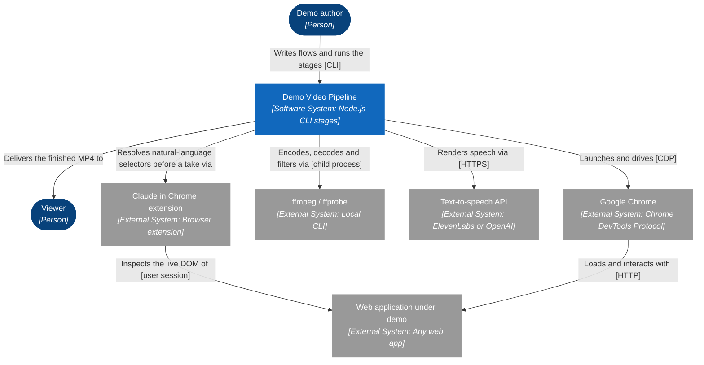

### Elements

| Element | Kind | Technology | Description |
|---|---|---|---|
| **Demo author** | Person | — | Developer or PM. Writes the flow as a .demo script, points it at a deployment with a target, then runs the stages in turn from a shell and checks the frames. |
| **Demo Video Pipeline** | Software System | `Node.js CLI stages` | Turns a plain-English flow into a narrated, branded MP4. Drives a real browser, captures frames and input telemetry, then assembles, zooms, composites, narrates, tightens and cards the result. The stages run one at a time, by hand. |
| **Viewer** | Person | — | Prospect, customer or internal audience. Watches the finished MP4; never touches the pipeline. |
| **Google Chrome** | External System | `Chrome + DevTools Protocol` | Driven by puppeteer-core on a dedicated user-data profile, so a login survives between takes. Frames come from Page.startScreencast. The cursor in the finished video is synthesized from telemetry rather than recorded, so the capture needs no real cursor. |
| **Web application under demo** | External System | `Any web app` | The deployment being recorded — localhost, staging, a customer sandbox, or a third-party app such as claude.ai. Named by a target; may require signing in. Flows run against live data, so the pipeline hovers rather than clicking anything destructive. |
| **ffmpeg / ffprobe** | External System | `Local CLI` | On PATH, or via FFMPEG / FFPROBE. Every encode, decode, probe and audio filter graph. The compositor also pipes raw RGBA through it in both directions, so no intermediate frame hits disk. |
| **Text-to-speech API** | External System | `ElevenLabs or OpenAI` | Chosen by DEMO_TTS, or by whichever key is set. Anthropic has no TTS API, so this is a third party. Keys come from the shell or .env, never a committed file. The only network dependency other than the app under demo. |
| **Claude in Chrome extension** | External System | `Browser extension` | Drives the user own Chrome, with their own session, so there is no SSO ritual and no email code to fill. Used before a take to turn the natural-language ask selectors in a script into concrete ones against the live DOM. It cannot record: it has screenshot capture but no screencast, so the take itself stays with the CDP driver. |

## C4-L2 — Containers

Level 2. The stages inside the pipeline and the files they hand work over through.

PlantUML: `docs/c4-l2-containers.puml`

```mermaid
flowchart TD
  n0(["Demo author<br/><i>[Person]</i>"])
  n3["Google Chrome<br/><i>[External System: Chrome + DevTools Protocol]</i>"]
  n4["Web application under demo<br/><i>[External System: Any web app]</i>"]
  n8["0 · Author<br/><i>[Container: author.mjs · Node.js]</i>"]
  n9[("Observed traces<br/><i>[File store: scenarios/*.trace.json]</i>")]
  n10["1 · Script Compiler<br/><i>[Container: script.mjs · Node.js]</i>"]
  n11["2 · Driver<br/><i>[Container: driver.mjs · Node.js + puppeteer-core]</i>"]
  n12["3 · Assembler<br/><i>[Container: assemble.mjs · Node.js + ffmpeg]</i>"]
  n13["4 · Zoom Projector<br/><i>[Container: project.mjs · Node.js]</i>"]
  n14["5 · Compositor<br/><i>[Container: compose.mjs · Node.js + canvas + ffmpeg]</i>"]
  n15["6 · Narrator<br/><i>[Container: narrate.mjs · Node.js + ffmpeg]</i>"]
  n16["7 · Tightener<br/><i>[Container: tighten.mjs · Node.js + ffmpeg]</i>"]
  n17["8 · Card Renderer<br/><i>[Container: cards.mjs · Node.js + canvas + ffmpeg]</i>"]
  n18[("Flow definitions<br/><i>[File store: input/ + scenarios/ authored, scripts/ generated]</i>")]
  n19[("Targets & secrets<br/><i>[File store: targets/*.json, *.local.json, .env]</i>")]
  n20[("Brand assets<br/><i>[File store: brand/]</i>")]
  n21[("Work directory<br/><i>[File store: out/]</i>")]
  n22[("TTS clip cache<br/><i>[File store: out/tts/ · mp3]</i>")]
  n23[("Selector resolutions<br/><i>[File store: scripts/*.selectors.json]</i>")]
  n7["Claude in Chrome extension<br/><i>[External System: Browser extension]</i>"]
  n5["ffmpeg / ffprobe<br/><i>[External System: Local CLI]</i>"]
  n6["Text-to-speech API<br/><i>[External System: ElevenLabs or OpenAI]</i>"]
  n0 -->|"Writes the flow"| n18
  n0 -->|"Sets the deployment and credentials"| n19
  n0 -->|"Runs once to generate the script [CLI]"| n8
  n7 -->|"Writes what it observed and measured"| n9
  n8 -->|"Reads the trace"| n9
  n8 -->|"Emits the .demo"| n18
  n8 -->|"Emits the sidecar, from the same trace"| n23
  n10 -->|"Compiles .demo, writes the scenario"| n18
  n10 -->|"Swaps each ask intent for its resolution"| n23
  n7 -->|"Writes what it found"| n23
  n7 -->|"Reads the ask intents"| n18
  n7 -->|"Inspects the live DOM of [user session]"| n4
  n11 -->|"Compiles a .demo on the way in [import]"| n10
  n11 -->|"Loads the scenario"| n18
  n11 -->|"Resolves app URL and credentials"| n19
  n11 -->|"Launches and drives [CDP]"| n3
  n3 -->|"Loads and interacts with [HTTP]"| n4
  n11 -->|"Writes frames + telemetry"| n21
  n12 -->|"Frames to MP4; shifts telemetry"| n21
  n13 -->|"Clicks to zoom regions"| n21
  n14 -->|"Take + project to final.mp4"| n21
  n14 -->|"Reads colours"| n20
  n15 -->|"Muxes narration onto the video"| n21
  n15 -->|"Caches clips"| n22
  n15 -->|"Renders speech [HTTPS]"| n6
  n16 -->|"Removes frozen + silent stretches"| n21
  n17 -->|"Joins intro/outro cards"| n21
  n17 -->|"Reads logo, colours, fonts"| n20
  n17 -->|"Caches card voice"| n22
  n17 -->|"Renders card voice [HTTPS]"| n6
  n12 -->|"Runs [child process]"| n5
  n14 -->|"Runs [child process]"| n5
  n15 -->|"Runs [child process]"| n5
  n16 -->|"Runs [child process]"| n5
  n17 -->|"Runs [child process]"| n5
  classDef person fill:#08427b,stroke:#08427b,color:#ffffff;
  classDef system fill:#1168bd,stroke:#1168bd,color:#ffffff;
  classDef external fill:#999999,stroke:#999999,color:#ffffff;
  classDef container fill:#438dd5,stroke:#438dd5,color:#ffffff;
  classDef store fill:#2e6da4,stroke:#2e6da4,color:#ffffff;
  classDef component fill:#85bbf0,stroke:#85bbf0,color:#000000;
  class n0 person;
  class n3,n4,n7,n5,n6 external;
  class n8,n10,n11,n12,n13,n14,n15,n16,n17 container;
  class n9,n18,n19,n20,n21,n22,n23 store;
```

### Elements

| Element | Kind | Technology | Description |
|---|---|---|---|
| **Demo author** | Person | — | Developer or PM. Writes the flow as a .demo script, points it at a deployment with a target, then runs the stages in turn from a shell and checks the frames. |
| **Google Chrome** | External System | `Chrome + DevTools Protocol` | Driven by puppeteer-core on a dedicated user-data profile, so a login survives between takes. Frames come from Page.startScreencast. The cursor in the finished video is synthesized from telemetry rather than recorded, so the capture needs no real cursor. |
| **Web application under demo** | External System | `Any web app` | The deployment being recorded — localhost, staging, a customer sandbox, or a third-party app such as claude.ai. Named by a target; may require signing in. Flows run against live data, so the pipeline hovers rather than clicking anything destructive. |
| **0 · Author** | Container | `author.mjs · Node.js` | Turns an observed walk of the app into the DSL. Reads a trace — the selectors found and the wait times measured — and emits the .demo and its selector sidecar together. Sizes the narration to each measured wait, reports any line that will not fit, and proposes a SPEEDS_MS range for whatever narration cannot cover. Optional: a .demo can be written by hand. |
| **Observed traces** | File store | `scenarios/*.trace.json` | What the app actually did on a real walk: the selector each step needs, the evidence for it, and how long every wait took. Authored, not generated — it is the only artifact here that cannot be rebuilt from something else, which is why it lives in scenarios/ rather than the gitignored out/. Also carries hazards the DSL cannot yet express, which the author writes into the script header. |
| **1 · Script Compiler** | Container | `script.mjs · Node.js` | Compiles a .demo flow into a normal, inspectable scenario module. Refuses to clobber a hand-written scenario. driver.mjs also calls it on the way in. |
| **2 · Driver** | Container | `driver.mjs · Node.js + puppeteer-core` | Launches Chrome, signs in if the target says to, runs the flow, and records a screencast plus cursor, click and narration-cue telemetry. Closes Chrome cleanly so cookies flush. |
| **3 · Assembler** | Container | `assemble.mjs · Node.js + ffmpeg` | Turns frames into raw.mp4 / cut.mp4. Applies CUTS_MS (drop) and SPEEDS_MS (keep, play fast) and puts the cursor and narration telemetry through the same shift, so nothing desyncs. Prints the largest inter-frame gaps. |
| **4 · Zoom Projector** | Container | `project.mjs · Node.js` | Clusters clicks less than 2.5s apart into zoom regions, each carrying a focusTrack the compositor pans across, and writes demo.recordly. |
| **5 · Compositor** | Container | `compose.mjs · Node.js + canvas + ffmpeg` | Renders every frame: eased zoom/pan, a synthesized cursor with click ripples, and a styled window frame. Frames stream through ffmpeg both ways; nothing hits disk. |
| **6 · Narrator** | Container | `narrate.mjs · Node.js + ffmpeg` | Voices the say-cues, trims the breath off each clip, levels every clip to a common loudness, and mixes them onto the video. Extends the video by holding the last frame if a closing line overruns it. |
| **7 · Tightener** | Container | `tighten.mjs · Node.js + ffmpeg` | Compresses stretches that are frozen AND silent, trims the trailing run, and crossfades every seam. Runs after narrate because silence is only meaningful once the voice is on the timeline. Refuses to write if a seam lands on speech or a zoom. |
| **8 · Card Renderer** | Container | `cards.mjs · Node.js + canvas + ffmpeg` | Renders branded intro/outro title cards, voices them with the same provider, and dissolves them on with the concat filter rather than the demuxer. |
| **Flow definitions** | File store | `input/ + scenarios/ authored, scripts/ generated` | What happens on screen and what is said over it. Split by who writes it: input/ holds the plain-English .flow and scenarios/ the .trace.json observed from walking it, both authored and worth reviewing; scripts/ holds the .demo the trace generates, plus its selector sidecar, either of which can be deleted and rebuilt. Committed; contains no credentials. |
| **Targets & secrets** | File store | `targets/*.json, *.local.json, .env` | Which deployment, and how to sign in. The .json is committed and holds no secrets; the .local.json and .env are gitignored. Any value may be written env:VAR_NAME and is read from the environment at load time. |
| **Brand assets** | File store | `brand/` | StyleGuide.txt (colour and type, the source of truth), the logo, and the font files. One directory is the brand; there is no flag to point elsewhere. |
| **Work directory** | File store | `out/` | frames/, frames.json, actions.json, the per-take cursor.json and narration.json, demo.recordly, and the MP4 at each stage: raw, cut, final, final-narrated, -tight, -carded. The hand-off between every stage. |
| **TTS clip cache** | File store | `out/tts/ · mp3` | One mp3 per line, keyed by provider+voice+text, plus the derived .lead.mp3 with the opening breath trimmed. Re-cutting or re-composing re-bills nothing; only changed lines re-render. |
| **Selector resolutions** | File store | `scripts/*.selectors.json` | What each ask description resolved to against the live DOM, plus the evidence for it. Kept beside the script rather than inside it, so the .demo keeps saying what you meant while the machine-found selector stays reviewable on its own. Keyed by intent text, so renaming a selector or reordering the block does not orphan a resolution. |
| **Claude in Chrome extension** | External System | `Browser extension` | Drives the user own Chrome, with their own session, so there is no SSO ritual and no email code to fill. Used before a take to turn the natural-language ask selectors in a script into concrete ones against the live DOM. It cannot record: it has screenshot capture but no screencast, so the take itself stays with the CDP driver. |
| **ffmpeg / ffprobe** | External System | `Local CLI` | On PATH, or via FFMPEG / FFPROBE. Every encode, decode, probe and audio filter graph. The compositor also pipes raw RGBA through it in both directions, so no intermediate frame hits disk. |
| **Text-to-speech API** | External System | `ElevenLabs or OpenAI` | Chosen by DEMO_TTS, or by whichever key is set. Anthropic has no TTS API, so this is a third party. Keys come from the shell or .env, never a committed file. The only network dependency other than the app under demo. |

## C4-L3 — Components · Author (author.mjs)

Level 3, container "0 · Author".

PlantUML: `docs/c4-l3-author.puml`

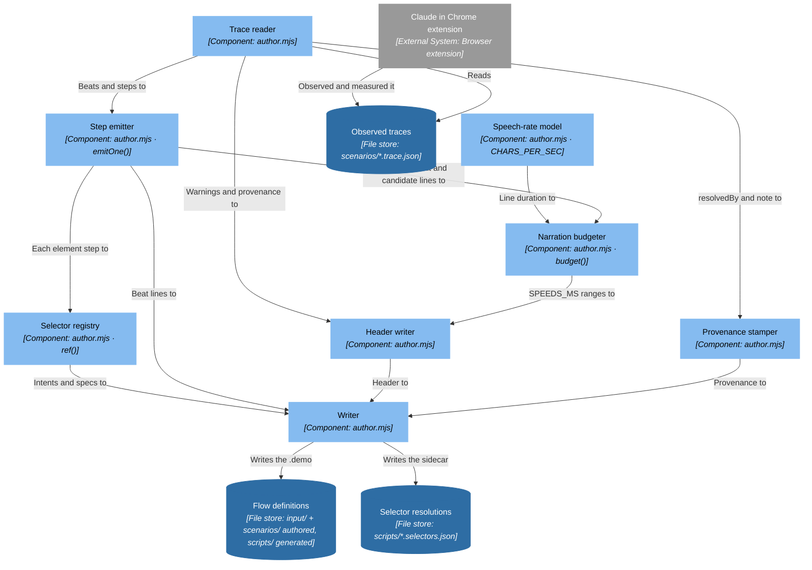

### Elements

| Element | Kind | Technology | Description |
|---|---|---|---|
| **Trace reader** | Component | `author.mjs` | Loads the trace and refuses one without a beats array. Everything downstream is derived from this single file, which is what makes the .demo and the sidecar agree by construction rather than by care. |
| **Speech-rate model** | Component | `author.mjs · CHARS_PER_SEC` | How long a line takes to say, at 12.5 characters per second. The first value, 15.5, was derived by dividing text length by the gap between cues — which silently included the pause after each line, so it ran fast and under-estimated every clip. Back-solved from three real overlap warnings the true rate is 12.0-13.7; the constant sits at the slow end deliberately, because over-estimating costs one fewer line while under-estimating makes two lines talk over each other. |
| **Narration budgeter** | Component | `author.mjs · budget()` | Fits as many lines as the measured wait allows, spacing them so none overlaps the next, and stops at a ceiling because wall-to-wall talking over a 40s wait reads worse than a visible fast-forward. Lines that do not fit are returned as unused rather than dropped in silence, and an uncovered stretch over six seconds becomes a SPEEDS_MS range. |
| **Selector registry** | Component | `author.mjs · ref()` | Runs once per step that touches an element and feeds both outputs from that one call: the name and intent go to the .demo selectors block, the spec and evidence to the sidecar. Neither file is written independently, so they cannot drift apart. |
| **Step emitter** | Component | `author.mjs · emitOne()` | One DSL line per trace step: say, hold, wait, type, press, click, hover. A waitGone pulls in the budgeter and labels the number measured or ESTIMATED, because a figure a reader trusts as measured when it was guessed is worse than no figure. An ifAppears becomes a short-timeout guard for UI that only shows up sometimes. |
| **Header writer** | Component | `author.mjs` | Writes the provenance line, any hazards the walk recorded, and the ready-to-paste SPEEDS_MS command. Hazards go in the file rather than a chat log because that is where the next person will look. |
| **Provenance stamper** | Component | `author.mjs` | Takes resolvedBy and the note from the trace instead of stamping them on. It used to hardcode claude-in-chrome, so a hand-authored trace produced a sidecar claiming it had been resolved live — the one lie that makes every other entry in the file untrustworthy. |
| **Writer** | Component | `author.mjs` | Writes the .demo and derives the sidecar path by swapping the extension — the same rule script.mjs uses to find it, which is why the two must sit together. Unused lines and SPEEDS_MS candidates are printed as notes for the person running it. |
| **Observed traces** | File store | `scenarios/*.trace.json` | What the app actually did on a real walk: the selector each step needs, the evidence for it, and how long every wait took. Authored, not generated — it is the only artifact here that cannot be rebuilt from something else, which is why it lives in scenarios/ rather than the gitignored out/. Also carries hazards the DSL cannot yet express, which the author writes into the script header. |
| **Flow definitions** | File store | `input/ + scenarios/ authored, scripts/ generated` | What happens on screen and what is said over it. Split by who writes it: input/ holds the plain-English .flow and scenarios/ the .trace.json observed from walking it, both authored and worth reviewing; scripts/ holds the .demo the trace generates, plus its selector sidecar, either of which can be deleted and rebuilt. Committed; contains no credentials. |
| **Selector resolutions** | File store | `scripts/*.selectors.json` | What each ask description resolved to against the live DOM, plus the evidence for it. Kept beside the script rather than inside it, so the .demo keeps saying what you meant while the machine-found selector stays reviewable on its own. Keyed by intent text, so renaming a selector or reordering the block does not orphan a resolution. |
| **Claude in Chrome extension** | External System | `Browser extension` | Drives the user own Chrome, with their own session, so there is no SSO ritual and no email code to fill. Used before a take to turn the natural-language ask selectors in a script into concrete ones against the live DOM. It cannot record: it has screenshot capture but no screencast, so the take itself stays with the CDP driver. |

## C4-L3 — Components · Script Compiler (script.mjs)

Level 3, container "1 · Script Compiler".

PlantUML: `docs/c4-l3-script-compiler.puml`

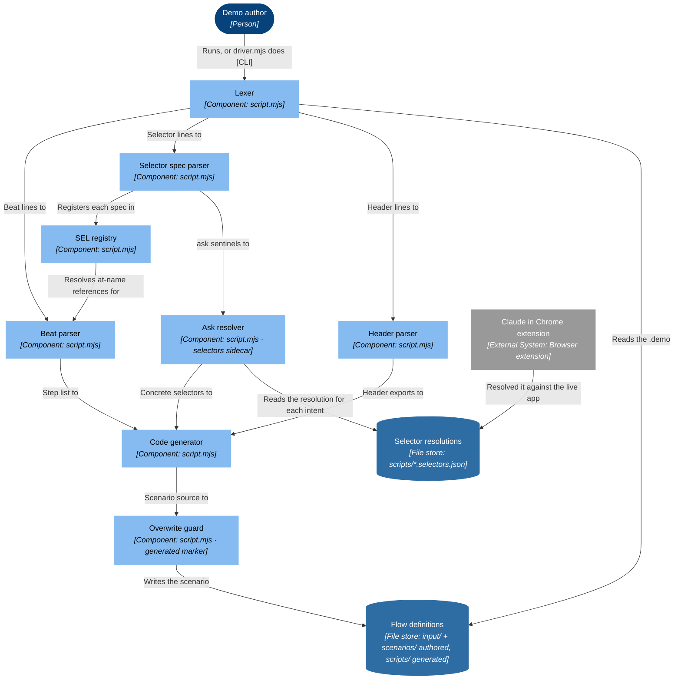

### Elements

| Element | Kind | Technology | Description |
|---|---|---|---|
| **Lexer** | Component | `script.mjs` | One command per line. Strips comments, parses durations such as 2s and 1500ms, splits a trailing within-timeout off a command, and unquotes strings. |
| **Selector spec parser** | Component | `script.mjs` | Turns the button, text and css forms of a selector line into the driver spec strings. A bare value takes the block default, which is why a CSS id needs the css prefix. |
| **SEL registry** | Component | `script.mjs` | Names in the selectors block become slugged keys on the exported SEL map, deduped so two similar labels cannot quietly collide on one key. |
| **Header parser** | Component | `script.mjs` | target, app, viewport, match, intro, outro and brand. An unknown directive is an error naming the file and line, not a silently ignored line. |
| **Beat parser** | Component | `script.mjs` | Beats of wait, click, hover, hold, type, press, scroll, open, login, logout, say and if-appears, each becoming one step in order. |
| **Ask resolver** | Component | `script.mjs · selectors sidecar` | An ask selector parses to a sentinel spec that travels through the registry as an ordinary string, then gets swapped here for what the sidecar resolved it to. Anything left unresolved is a compile error, never a guess: a guessed selector does not fail here, it fails mid-take with the browser up and the recording started, which is the expensive place to fail. |
| **Code generator** | Component | `script.mjs` | Emits a scenario module: the SEL map, run(d), and the header exports. Ordinary readable JavaScript, so the generated file is inspectable and hand-editable rather than a black box. |
| **Overwrite guard** | Component | `script.mjs · generated marker` | Refuses to overwrite a scenario it did not generate; a marker in the header is what tells them apart. Use -o to write elsewhere. |
| **Demo author** | Person | — | Developer or PM. Writes the flow as a .demo script, points it at a deployment with a target, then runs the stages in turn from a shell and checks the frames. |
| **Flow definitions** | File store | `input/ + scenarios/ authored, scripts/ generated` | What happens on screen and what is said over it. Split by who writes it: input/ holds the plain-English .flow and scenarios/ the .trace.json observed from walking it, both authored and worth reviewing; scripts/ holds the .demo the trace generates, plus its selector sidecar, either of which can be deleted and rebuilt. Committed; contains no credentials. |
| **Selector resolutions** | File store | `scripts/*.selectors.json` | What each ask description resolved to against the live DOM, plus the evidence for it. Kept beside the script rather than inside it, so the .demo keeps saying what you meant while the machine-found selector stays reviewable on its own. Keyed by intent text, so renaming a selector or reordering the block does not orphan a resolution. |
| **Claude in Chrome extension** | External System | `Browser extension` | Drives the user own Chrome, with their own session, so there is no SSO ritual and no email code to fill. Used before a take to turn the natural-language ask selectors in a script into concrete ones against the live DOM. It cannot record: it has screenshot capture but no screencast, so the take itself stays with the CDP driver. |

## C4-L3 — Components · Driver (driver.mjs)

Level 3, container "2 · Driver".

PlantUML: `docs/c4-l3-driver.puml`

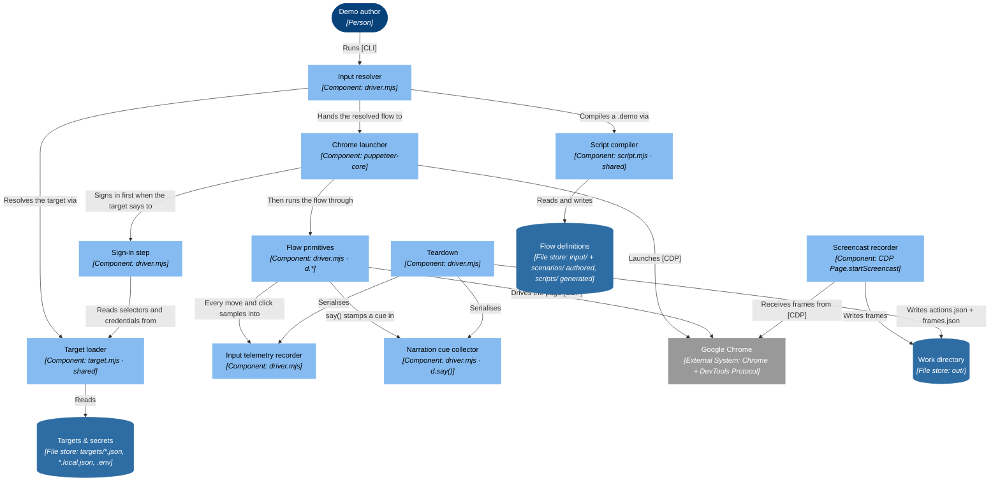

### Elements

| Element | Kind | Technology | Description |
|---|---|---|---|
| **Demo author** | Person | — | Developer or PM. Writes the flow as a .demo script, points it at a deployment with a target, then runs the stages in turn from a shell and checks the frames. |
| **Input resolver** | Component | `driver.mjs` | Reads argv. Anything not ending .mjs/.js is treated as a script and compiled; a target comes from --target, DEMO_TARGET, or a TARGET export on the scenario. |
| **Script compiler** | Component | `script.mjs · shared` | Parses the .demo grammar — header directives, a selectors block, then beats — and emits a scenario module. The generated file is inspectable and hand-editable, so the script is a starting point rather than a black box. |
| **Target loader** | Component | `target.mjs · shared` | Deep-merges the target JSON, its .local.json sidecar, .env and the DEMO_* env vars, later winning, and resolves env:VAR_NAME values at load time. The one place credentials are allowed to appear. |
| **Chrome launcher** | Component | `puppeteer-core` | Runs a real Chrome on profile/, pinned to --force-device-scale-factor=1 so display scaling cannot change the frame size. On macOS keeps --use-mock-keychain so profile cookies decrypt. |
| **Sign-in step** | Component | `driver.mjs` | Fills the target's auth.selectors and waits the app out. auth.start decides whether the take opens signed-out, with the login part of the demo, or signed-in, with the login happening off-camera before capture starts. |
| **Flow primitives** | Component | `driver.mjs · d.*` | hold, waitSel, waitGone, appears, hoverSel, clickSel, type, key, wheel, open, race, login, logout. d.type verifies the click actually focused the element and refuses to type into the wrong one rather than sending text to whatever has focus. |
| **Screencast recorder** | Component | `CDP Page.startScreencast` | Acks every frame and writes out/frames/*.jpg plus frames.json. Gated on the take, so an off-camera sign-in never reaches the video. |
| **Input telemetry recorder** | Component | `driver.mjs` | Samples synthesized pointer moves and clicks into actions.json. The cursor in the finished video is drawn from this, which is why the capture needs no real cursor. |
| **Narration cue collector** | Component | `driver.mjs · d.say()` | Stamps { t, text } at wall-clock time and returns immediately — the voice plays over the visuals instead of the flow pausing for it. Cue times are recorded during the take precisely because beat length varies per run. |
| **Teardown** | Component | `driver.mjs` | Stops the screencast, writes frames.json and actions.json, and closes Chrome by its window rather than killing it, so unflushed session state is not lost. |
| **Google Chrome** | External System | `Chrome + DevTools Protocol` | Driven by puppeteer-core on a dedicated user-data profile, so a login survives between takes. Frames come from Page.startScreencast. The cursor in the finished video is synthesized from telemetry rather than recorded, so the capture needs no real cursor. |
| **Flow definitions** | File store | `input/ + scenarios/ authored, scripts/ generated` | What happens on screen and what is said over it. Split by who writes it: input/ holds the plain-English .flow and scenarios/ the .trace.json observed from walking it, both authored and worth reviewing; scripts/ holds the .demo the trace generates, plus its selector sidecar, either of which can be deleted and rebuilt. Committed; contains no credentials. |
| **Targets & secrets** | File store | `targets/*.json, *.local.json, .env` | Which deployment, and how to sign in. The .json is committed and holds no secrets; the .local.json and .env are gitignored. Any value may be written env:VAR_NAME and is read from the environment at load time. |
| **Work directory** | File store | `out/` | frames/, frames.json, actions.json, the per-take cursor.json and narration.json, demo.recordly, and the MP4 at each stage: raw, cut, final, final-narrated, -tight, -carded. The hand-off between every stage. |

## C4-L3 — Components · Assembler (assemble.mjs)

Level 3, container "3 · Assembler".

PlantUML: `docs/c4-l3-assembler.puml`

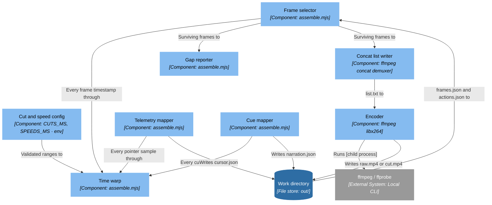

### Elements

| Element | Kind | Technology | Description |
|---|---|---|---|
| **Cut and speed config** | Component | `CUTS_MS, SPEEDS_MS · env` | Two ways to shorten a take: a cut drops the frames, a speed keeps them and plays them fast. Reach for a speed first — a cut across an answer being written lands the viewer on a finished table having never seen it arrive. A reversed range, a factor at or below 1, or a cut overlapping a speed is rejected, because both cannot apply. |
| **Time warp** | Component | `assemble.mjs` | The single function that moves a timestamp. Ranges are applied partially when a timestamp falls inside one, which keeps a sped-up span in sync with itself rather than only at its far edge. No other stage does its own; that is what stops the picture and the voice drifting apart. |
| **Frame selector** | Component | `assemble.mjs` | Drops frames inside a cut and rewrites the timestamp of the rest. Fewer than ten survivors is an error naming the cut rather than a two-frame video. |
| **Gap reporter** | Component | `assemble.mjs` | Prints the five largest inter-frame gaps over a second. Those are exactly where the video freezes, so they are the candidates for the next cut. |
| **Concat list writer** | Component | `ffmpeg concat demuxer` | A file and duration pair per frame, with the last frame repeated so its duration is honoured. Paths go in with forward slashes because the demuxer treats a backslash as an escape. |
| **Encoder** | Component | `ffmpeg libx264` | Scales to 1920x1080 with lanczos at 60fps, CRF 18. |
| **Telemetry mapper** | Component | `assemble.mjs` | Normalises pointer samples to 0..1 of the viewport, drops what fell inside a cut, and warps the rest. Nothing surviving is an error, because a silent empty cursor track is worse. |
| **Cue mapper** | Component | `assemble.mjs` | The identical filter and warp for narration cues, and it reports how many were dropped inside cuts. Doing this anywhere else silently desyncs the voiceover from the picture. |
| **Work directory** | File store | `out/` | frames/, frames.json, actions.json, the per-take cursor.json and narration.json, demo.recordly, and the MP4 at each stage: raw, cut, final, final-narrated, -tight, -carded. The hand-off between every stage. |
| **ffmpeg / ffprobe** | External System | `Local CLI` | On PATH, or via FFMPEG / FFPROBE. Every encode, decode, probe and audio filter graph. The compositor also pipes raw RGBA through it in both directions, so no intermediate frame hits disk. |

## C4-L3 — Components · Zoom Projector (project.mjs)

Level 3, container "4 · Zoom Projector".

PlantUML: `docs/c4-l3-zoom-projector.puml`

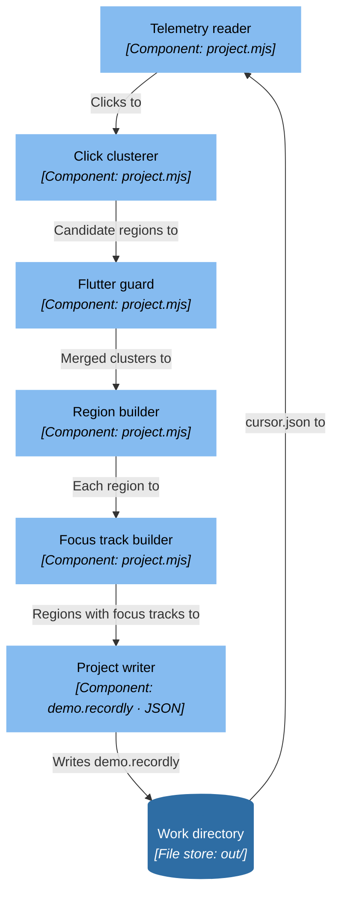

### Elements

| Element | Kind | Technology | Description |
|---|---|---|---|
| **Telemetry reader** | Component | `project.mjs` | Takes the cursor.json beside the newest take, cut.mp4 before raw.mp4, and keeps the clicks. No clicks is an error rather than an empty project. |
| **Click clusterer** | Component | `project.mjs` | Clicks less than 2500ms apart become one region — opening a menu and picking an item is one move to the viewer, not two. |
| **Flutter guard** | Component | `project.mjs` | Two regions that would sit less than 800ms apart are merged, so the zoom holds instead of bouncing out and straight back in. |
| **Region builder** | Component | `project.mjs` | Starts 1200ms before the first click and ends 1600ms after the last, at depth 3, with focus clamped to 0.08..0.92 so a corner click still frames something. |
| **Focus track builder** | Component | `project.mjs` | Keeps every click position in a cluster, not only the last. A merged region can span clicks far apart on screen, and the compositor pans across them instead of framing the final one and leaving the earlier ones off screen. |
| **Project writer** | Component | `demo.recordly · JSON` | videoPath plus the regions, and it prints each region with its focus track so the framing can be reviewed before composing. |
| **Work directory** | File store | `out/` | frames/, frames.json, actions.json, the per-take cursor.json and narration.json, demo.recordly, and the MP4 at each stage: raw, cut, final, final-narrated, -tight, -carded. The hand-off between every stage. |

## C4-L3 — Components · Compositor (compose.mjs)

Level 3, container "5 · Compositor".

PlantUML: `docs/c4-l3-compositor.puml`

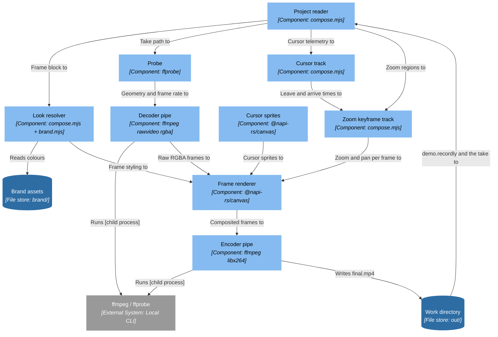

### Elements

| Element | Kind | Technology | Description |
|---|---|---|---|
| **Project reader** | Component | `compose.mjs` | Reads demo.recordly and the take it names, so the composite is always of the video the project was built from. |
| **Look resolver** | Component | `compose.mjs + brand.mjs` | padding, radius, shadow, background, ramp and pan timings, from the project frame block and overridable by NO_FRAME and PADDING. The mat the window sits on is the brand blue: it is most of what the viewer sees for the length of the demo, so either it carries the brand colour or the video does not have one. |
| **Probe** | Component | `ffprobe` | Dimensions, frame rate and frame count of the take. |
| **Cursor track** | Component | `compose.mjs` | Splits telemetry into moves and clicks, then works out when the cursor actually left one point and settled on the next. A held zoom that jumps between click positions would otherwise leave the cursor off screen while it travels. |
| **Zoom keyframe track** | Component | `compose.mjs` | Four keyframes per region — ramp up, hold, hold, ramp down — interpolated with an ease-in-out cubic. Between regions the track sits at zoom 1, where focus is irrelevant, so interpolating across the gap is safe. |
| **Cursor sprites** | Component | `@napi-rs/canvas` | Arrow and pointing hand drawn once into sprites, then composited with a press scale and a click ripple. This is why the capture needs no real cursor. |
| **Frame renderer** | Component | `@napi-rs/canvas` | Per frame: the source into its own canvas, the zoom transform clipped to the rounded window, the shadow, then the cursor on top. |
| **Decoder pipe** | Component | `ffmpeg rawvideo rgba` | Streams the take in. The decoder delivers small pipe chunks, which are reassembled into one reused frame buffer rather than a freshly concatenated one per frame. |
| **Encoder pipe** | Component | `ffmpeg libx264` | Takes rendered frames straight back, with faststart. Backpressure is respected by waiting on drain rather than buffering the whole video. |
| **Work directory** | File store | `out/` | frames/, frames.json, actions.json, the per-take cursor.json and narration.json, demo.recordly, and the MP4 at each stage: raw, cut, final, final-narrated, -tight, -carded. The hand-off between every stage. |
| **Brand assets** | File store | `brand/` | StyleGuide.txt (colour and type, the source of truth), the logo, and the font files. One directory is the brand; there is no flag to point elsewhere. |
| **ffmpeg / ffprobe** | External System | `Local CLI` | On PATH, or via FFMPEG / FFPROBE. Every encode, decode, probe and audio filter graph. The compositor also pipes raw RGBA through it in both directions, so no intermediate frame hits disk. |

## C4-L3 — Components · Narrator (narrate.mjs)

Level 3, container "6 · Narrator".

PlantUML: `docs/c4-l3-narrator.puml`

```mermaid
flowchart TD
  n73["Cue file resolver<br/><i>[Component: narrate.mjs]</i>"]
  n74["TTS gateway<br/><i>[Component: tts.mjs · shared]</i>"]
  n75["Breath trimmer<br/><i>[Component: tts.mjs · ffmpeg astats]</i>"]
  n76["Loudness meter<br/><i>[Component: ffmpeg ebur128]</i>"]
  n77["Clip leveller<br/><i>[Component: ffmpeg volume]</i>"]
  n78["Overlap checker<br/><i>[Component: narrate.mjs]</i>"]
  n79["Tail guard<br/><i>[Component: ffmpeg tpad]</i>"]
  n80["Mix graph builder<br/><i>[Component: ffmpeg filter_complex]</i>"]
  n81["Muxer<br/><i>[Component: ffmpeg]</i>"]
  n22[("TTS clip cache<br/><i>[File store: out/tts/ · mp3]</i>")]
  n6["Text-to-speech API<br/><i>[External System: ElevenLabs or OpenAI]</i>"]
  n21[("Work directory<br/><i>[File store: out/]</i>")]
  n5["ffmpeg / ffprobe<br/><i>[External System: Local CLI]</i>"]
  n73 -->|"Reads demo.recordly + the cue file"| n21
  n73 -->|"One line at a time to"| n74
  n74 -->|"Hits before spending"| n22
  n74 -->|"Renders a miss [HTTPS]"| n6
  n74 -->|"Derives a trimmed clip via"| n75
  n75 -->|"Writes .lead.mp3 beside the original"| n22
  n75 -->|"Trimmed clip to"| n76
  n76 -->|"Integrated LUFS to"| n77
  n73 -->|"Cue times + clip lengths to"| n78
  n73 -->|"Last cue end vs video length to"| n79
  n77 -->|"Per-clip gain to"| n80
  n79 -->|"Pad duration to"| n80
  n80 -->|"Filter graph to"| n81
  n81 -->|"Runs [child process]"| n5
  n81 -->|"Writes final-narrated.mp4"| n21
  classDef person fill:#08427b,stroke:#08427b,color:#ffffff;
  classDef system fill:#1168bd,stroke:#1168bd,color:#ffffff;
  classDef external fill:#999999,stroke:#999999,color:#ffffff;
  classDef container fill:#438dd5,stroke:#438dd5,color:#ffffff;
  classDef store fill:#2e6da4,stroke:#2e6da4,color:#ffffff;
  classDef component fill:#85bbf0,stroke:#85bbf0,color:#000000;
  class n6,n5 external;
  class n22,n21 store;
  class n73,n74,n75,n76,n77,n78,n79,n80,n81 component;
```

### Elements

| Element | Kind | Technology | Description |
|---|---|---|---|
| **Cue file resolver** | Component | `narrate.mjs` | Reads videoPath out of demo.recordly to find the cue file belonging to the take that was actually composed, falling back to newest-mtime. Using another take’s cues does not error — it silently narrates over the wrong footage — so the project file, not the timestamp, is the authority. |
| **TTS gateway** | Component | `tts.mjs · shared` | Shared with cards.mjs, which is why both stages voice a script identically. Picks the provider, then hits a content-addressed cache keyed by provider+voice+text before spending anything. |
| **Breath trimmer** | Component | `tts.mjs · ffmpeg astats` | TTS does not start on the word; it starts on 100-160ms at -50 to -85 dB. Cued at the file start that is heard as the line fading up, and normalising a breath just gives a louder breath. Measures RMS in 20ms windows — silenceremove decides on peaks and keeps it — and derives a .lead.mp3 without re-billing. |
| **Loudness meter** | Component | `ffmpeg ebur128` | Integrated LUFS per clip. Providers do not return lines at a consistent level: measured here, 4.1 LU across one script, worst on the short lines. |
| **Clip leveller** | Component | `ffmpeg volume` | Static gain to NARRATION_PREMIX_LUFS (-20), capped at ±6 dB, applied per clip before the mix. Static rather than a second loudnorm, which would ride the syllables inside a line. This is the step that cannot be done later: a dynamic pass over the finished mix sets the level of the track, never of a line. |
| **Overlap checker** | Component | `narrate.mjs` | Warns when one line runs into the next rather than letting two clips talk over each other. The fix is a longer hold or a shorter line, both in the script. |
| **Tail guard** | Component | `ffmpeg tpad` | A screencast stops emitting frames when the page stops changing, so a closing line can outlast the video; the last frame is held to cover it. Past PAD_LIMIT_MS that is not a long closing line but the wrong cue file, and the stage throws. |
| **Mix graph builder** | Component | `ffmpeg filter_complex` | Per clip: volume, then adelay to the cue time. Then amix, apad, and the master chain — speechnorm to lift soft line openings, loudnorm to -16 LUFS with true peak under -1.5 dB. Both leave digital silence alone, so the tightener can still find the silent stretches afterwards. |
| **Muxer** | Component | `ffmpeg` | Copies the video stream untouched unless the tail guard needed extra room, so the stage costs seconds rather than a re-render. |
| **TTS clip cache** | File store | `out/tts/ · mp3` | One mp3 per line, keyed by provider+voice+text, plus the derived .lead.mp3 with the opening breath trimmed. Re-cutting or re-composing re-bills nothing; only changed lines re-render. |
| **Text-to-speech API** | External System | `ElevenLabs or OpenAI` | Chosen by DEMO_TTS, or by whichever key is set. Anthropic has no TTS API, so this is a third party. Keys come from the shell or .env, never a committed file. The only network dependency other than the app under demo. |
| **Work directory** | File store | `out/` | frames/, frames.json, actions.json, the per-take cursor.json and narration.json, demo.recordly, and the MP4 at each stage: raw, cut, final, final-narrated, -tight, -carded. The hand-off between every stage. |
| **ffmpeg / ffprobe** | External System | `Local CLI` | On PATH, or via FFMPEG / FFPROBE. Every encode, decode, probe and audio filter graph. The compositor also pipes raw RGBA through it in both directions, so no intermediate frame hits disk. |

## C4-L3 — Components · Tightener (tighten.mjs)

Level 3, container "7 · Tightener".

PlantUML: `docs/c4-l3-tightener.puml`

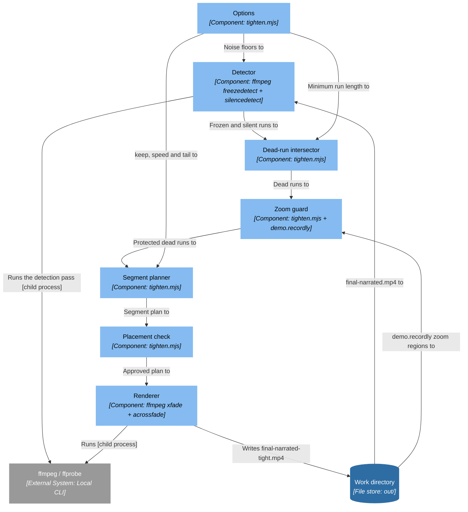

### Elements

| Element | Kind | Technology | Description |
|---|---|---|---|
| **Options** | Component | `tighten.mjs` | min, keep, speed, tail, xfade and the two detector floors. Every default errs toward leaving the video alone, because the failure mode here is squeezing too hard and that does not announce itself: the output is simply a video that feels rushed. |
| **Detector** | Component | `ffmpeg freezedetect + silencedetect` | One pass, both filters. It reports on stderr and exits 0, so the output is read from a spawn rather than a throwing exec. A run still open at the end of the file is closed at the duration rather than dropped, because that trailing run is the one that matters most. |
| **Dead-run intersector** | Component | `tighten.mjs` | Dead means frozen AND silent. Either signal alone is wrong: a frozen screen under a narration line is the shot that line is playing over, and silence over a moving screen is a stretch that needs narrating, not cutting. Touching runs are merged so two detections do not become two seams. |
| **Zoom guard** | Component | `tighten.mjs + demo.recordly` | Zoom windows are subtracted from the dead runs outright. A dead run butts right up against a zoom, because the zoom is triggered by a click and the screen goes still immediately after it, so a seam there dissolves the move and turns it into a snap. |
| **Segment planner** | Component | `tighten.mjs` | Live stretches at 1x, dead ones at up to speed, never leaving less than keep of screen time. A run too short to hold a seam at each end, or one saving under 0.8s, is left alone: a seam is never free, and shaving 0.2s off a pause does not pay for one. |
| **Placement check** | Component | `tighten.mjs` | Re-verifies every seam against the detected silence and the zoom list, and refuses to write if one is over either. Not belt and braces: a seam on a run edge fades a narration line up from nothing, and nothing catches that except watching the video. |
| **Renderer** | Component | `ffmpeg xfade + acrossfade` | Each segment is trimmed and retimed, then dissolved into the next over a fade long enough to see. atempo only ever stretches silence, so the narration itself is never pitched or hurried. |
| **Work directory** | File store | `out/` | frames/, frames.json, actions.json, the per-take cursor.json and narration.json, demo.recordly, and the MP4 at each stage: raw, cut, final, final-narrated, -tight, -carded. The hand-off between every stage. |
| **ffmpeg / ffprobe** | External System | `Local CLI` | On PATH, or via FFMPEG / FFPROBE. Every encode, decode, probe and audio filter graph. The compositor also pipes raw RGBA through it in both directions, so no intermediate frame hits disk. |

## C4-L3 — Components · Card Renderer (cards.mjs)

Level 3, container "8 · Card Renderer".

PlantUML: `docs/c4-l3-card-renderer.puml`

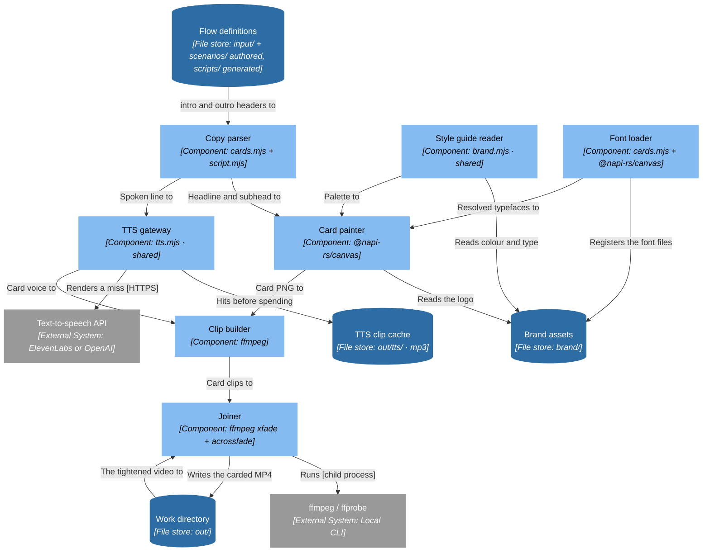

### Elements

| Element | Kind | Technology | Description |
|---|---|---|---|
| **Copy parser** | Component | `cards.mjs + script.mjs` | The intro and outro header directives, split on a pipe into headline and subhead. Both appear on the card and both are read aloud. Without a pipe the text becomes the subhead under a default headline. |
| **Style guide reader** | Component | `brand.mjs · shared` | Colour and type from brand/StyleGuide.txt, shared with the compositor so the style-guide hex cannot end up in one stage and not the other. |
| **Font loader** | Component | `cards.mjs + @napi-rs/canvas` | Registers every font file in the brand directory. Falls back loudly and states what the card is actually set in, because a silent fallback and a successful resolve otherwise look identical in the log. |
| **Card painter** | Component | `@napi-rs/canvas` | The brand hex flat across the top 55% and deepening below, so sampling the field returns the style-guide colour rather than a near-black navy. Then the logo, the CTA green rule, and the type wrapped and balanced so two lines do not come out as a long one and a stub. The block is measured first, then drawn optically centred. |
| **TTS gateway** | Component | `tts.mjs · shared` | The same provider, cache and breath trim the narrator uses. Sharing it is why the cards sit at the same level as the body of the video instead of the join being audible. |
| **Clip builder** | Component | `ffmpeg` | Still plus voice, with a lead-in long enough to clear the dissolve. The outro is the incoming side of the last fade, so a shorter lead would put its first word inside that fade — the one place a card can start quiet. Only the outer edges fade to black. |
| **Joiner** | Component | `ffmpeg xfade + acrossfade` | Normalises frame rate, pixel format and timebase on every input first, then dissolves card into demo. Filters rather than the concat demuxer, so mismatched encoder settings between the cards and the composed video cannot corrupt the join. |
| **Flow definitions** | File store | `input/ + scenarios/ authored, scripts/ generated` | What happens on screen and what is said over it. Split by who writes it: input/ holds the plain-English .flow and scenarios/ the .trace.json observed from walking it, both authored and worth reviewing; scripts/ holds the .demo the trace generates, plus its selector sidecar, either of which can be deleted and rebuilt. Committed; contains no credentials. |
| **Brand assets** | File store | `brand/` | StyleGuide.txt (colour and type, the source of truth), the logo, and the font files. One directory is the brand; there is no flag to point elsewhere. |
| **TTS clip cache** | File store | `out/tts/ · mp3` | One mp3 per line, keyed by provider+voice+text, plus the derived .lead.mp3 with the opening breath trimmed. Re-cutting or re-composing re-bills nothing; only changed lines re-render. |
| **Text-to-speech API** | External System | `ElevenLabs or OpenAI` | Chosen by DEMO_TTS, or by whichever key is set. Anthropic has no TTS API, so this is a third party. Keys come from the shell or .env, never a committed file. The only network dependency other than the app under demo. |
| **Work directory** | File store | `out/` | frames/, frames.json, actions.json, the per-take cursor.json and narration.json, demo.recordly, and the MP4 at each stage: raw, cut, final, final-narrated, -tight, -carded. The hand-off between every stage. |
| **ffmpeg / ffprobe** | External System | `Local CLI` | On PATH, or via FFMPEG / FFPROBE. Every encode, decode, probe and audio filter graph. The compositor also pipes raw RGBA through it in both directions, so no intermediate frame hits disk. |
